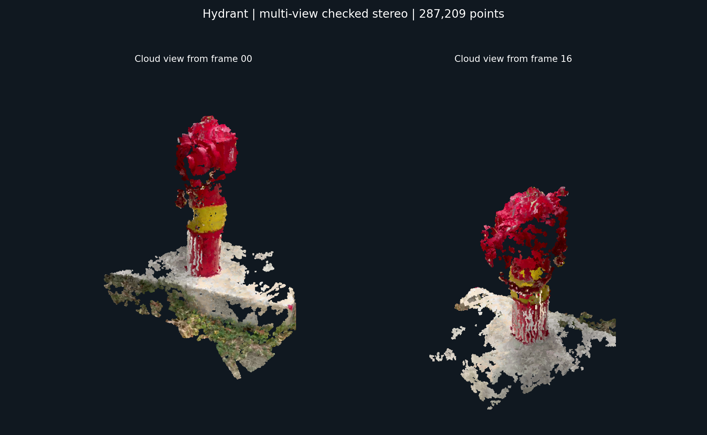
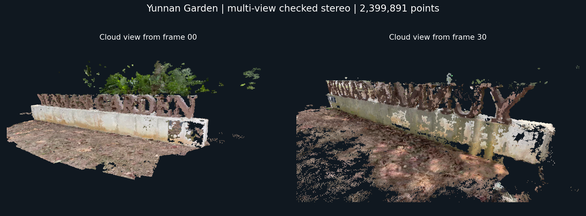

# AI6121 · 视频 Structure from Motion

使用 OpenCV 基础函数与 NumPy/SciPy，从视频估计相机位姿并重建彩色点云。保留全部 **2 fps** 采样帧，自己实现轨迹管理、多视图三角化和 Schur-LM Bundle Adjustment；不调用 COLMAP、PyCOLMAP、Ceres 或其他完整 SfM 重建框架。

本项目基于 [zaarAli/i-sfm](https://github.com/zaarAli/i-sfm) 继续开发，保留原 [MIT 许可证](LICENSE) 与论文引用，具体来源和修改范围见 [开源致谢](ATTRIBUTION.md)。

## 安装与运行

在仓库根目录执行，使用 Python 3.11：

```bash
python3.11 -m venv .venv
.venv/bin/python -m pip install -r requirements-core.txt

# 两个演示：稀疏重建 → 独立检查 → OpenCV 立体点云 → 预览
make demos

# 或仅运行基础稀疏重建
.venv/bin/python run_sfm.py --video demos/hydrant/input.mp4 --fps 2 --max-frames 0 --refine-focal --output outputs/my_hydrant
```

`make demo-hydrant` 和 `make demo-garden` 可单独运行。所有输出目录必须新建或为空，已有结果不会被覆盖。环境不在 `.venv` 时使用 `make demos PYTHON=/path/to/python`。

## 两段视频演示

原视频、彩色稀疏点云、轻量立体点云预览、PNG 和运行统计位于 [demos/](demos/README.md)。点击视频链接可查看或下载；完整点云及逐帧记录可用上面的命令重新生成。

| 消防栓 | 花园标牌 |
|---|---|
| [原视频](demos/hydrant/input.mp4) · [稀疏 PLY](demos/hydrant/reconstruction.ply) | [原视频](demos/garden/input.mp4) · [稀疏 PLY](demos/garden/reconstruction.ply) |
|  |  |

预览图由实际重建的立体点云投影生成，没有叠加原照片。内参采用估计值并可优化共享焦距；场景包含背景、没有真实尺度，误差统计用于流程检查。

## 代码结构与验证

- `run_sfm.py`：命令行、抽帧、估计/读取内参、日志和输出。
- `matching.py`、`feature_cache.py`：SIFT/BF 匹配及可选特征缓存。
- `track_graph.py`、`incremental_sfm.py`：跨帧轨迹、初始化、PnP 注册、DLT 三角化。
- `sparse_ba.py`：自编稀疏 Schur-LM BA。
- `basic_backend.py`、`quality_checks.py`、`ply_io.py`：流程编排、质量检查、彩色点云读写。
- `scripts/`：独立验证、基础立体匹配、点云渲染；`tests/`：相关回归测试。

[中文实现与运行说明](BASIC_SFM_GUIDE_ZH.md) 说明算法、参数和验收条件。

```bash
.venv/bin/python -m pip install -r requirements-dev.txt
make test
```
